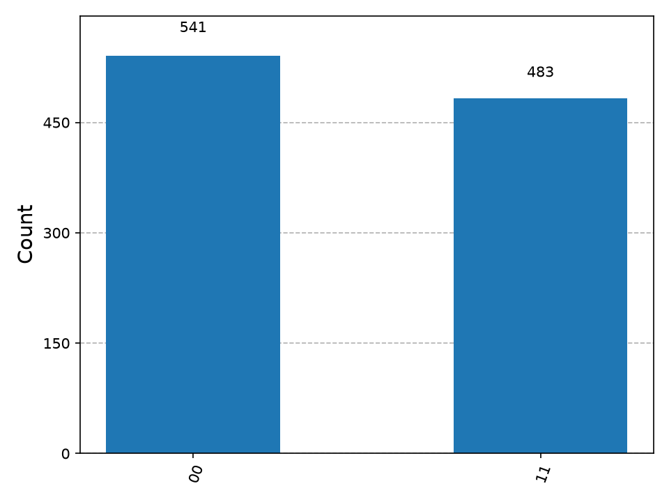
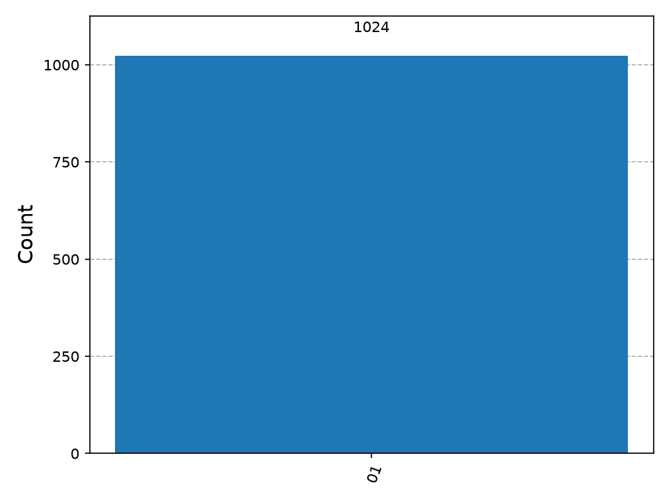
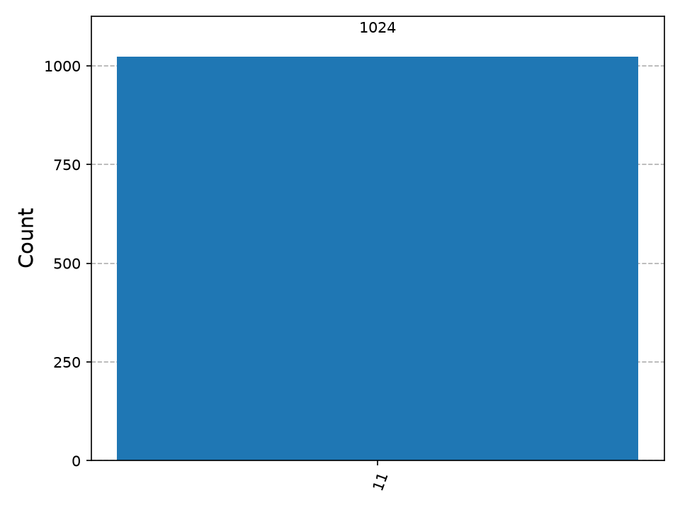
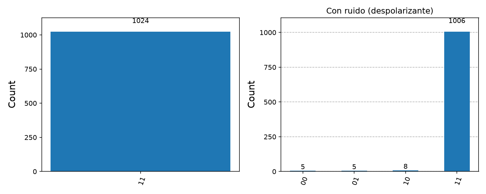
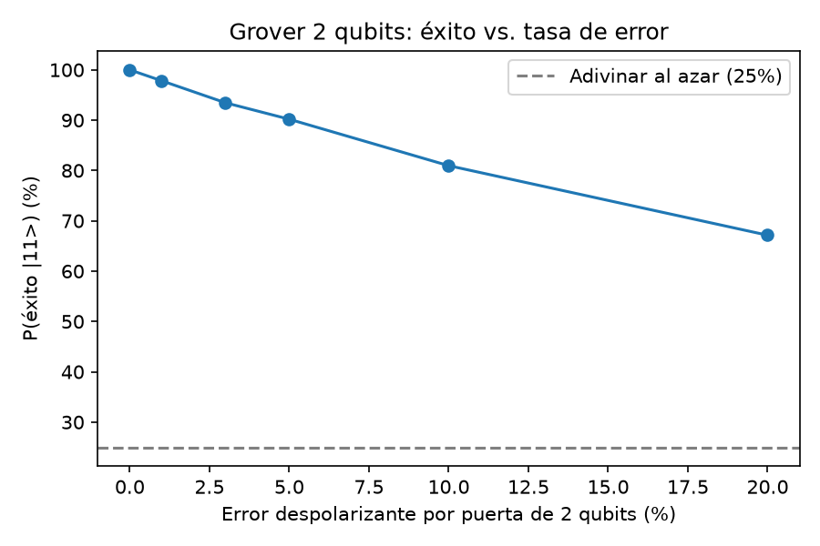

# Laboratorio de Computación Cuántica con Qiskit y Análisis PQC

**Arquitectura de Computadores · Unidad 12 · Post-contenido**
Repositorio único para ambas partes: **Parte 1** (circuitos cuánticos en Qiskit) y **Parte 2** (impacto cuántico en ciberseguridad, en [`docs/analisis-pqc.md`](docs/analisis-pqc.md)).

- **Autor:** `<Nombre Apellido>` · **Código:** `<código>` · **Fecha:** `<fecha>`

---

## Estructura del repositorio

```
apellido-post1-u12/
├── README.md                  # Este archivo (Parte 1 + guía de uso)
├── requirements.txt           # Dependencias (Qiskit 1.x, Aer, matplotlib)
├── .gitignore
├── src/
│   ├── bell_state.py          # Experimento 1: estado de Bell
│   ├── deutsch_jozsa.py       # Experimento 2: Deutsch-Jozsa (n=2)
│   ├── grover.py              # Experimento 3: Grover de 2 qubits
│   └── grover_noise.py        # Experimento 4: Grover con NoiseModel + barrido de error
├── capturas/                  # Histogramas generados por los scripts
│   ├── bell_histogram.png
│   ├── grover_00.png  grover_01.png  grover_10.png  grover_11.png
│   ├── grover_noise_comparison.png
│   └── grover_error_sweep.png
└── docs/
    └── analisis-pqc.md        # Parte 2: análisis post-cuántico
```

## Cómo ejecutar

```bash
python -m venv .venv && source .venv/bin/activate     # Windows: .venv\Scripts\activate
pip install -r requirements.txt
python -c "import qiskit; print(qiskit.__version__)"  # debe ser 1.x

python src/bell_state.py
python src/deutsch_jozsa.py
python src/grover.py
python src/grover_noise.py
```

Todo corre en el simulador clásico `AerSimulator`; no se necesita hardware cuántico ni cuenta de IBM Quantum. Los histogramas se guardan en `capturas/`.

> **Convención de Qiskit (importante):** las cadenas de bits se leen en orden *little-endian*: en `"01"`, el bit derecho (`1`) es el **qubit 0** y el izquierdo (`0`) es el **qubit 1**. Esto afecta al oráculo de Grover (ver Experimento 3).

---

## Experimento 1: Estado de Bell |Φ⁺⟩

**Circuito**

```
     ┌───┐     ┌─┐
q_0: ┤ H ├──■──┤M├───
     └───┘┌─┴─┐└╥┘┌─┐
q_1: ─────┤ X ├─╫─┤M├
          └───┘ ║ └╥┘
c: 2/═══════════╩══╩═
                0  1
```

Hadamard sobre el qubit 0 crea la superposición (|0⟩+|1⟩)/√2; la CNOT la propaga al qubit 1 y produce **(|00⟩ + |11⟩)/√2**. Medir un qubit fija el resultado del otro: correlación perfecta, que es la huella del entrelazamiento.

| Estado | Esperado | Obtenido (1024 shots) |
|---|---|---|
| `00` | ≈ 50 % | `<completar>` |
| `11` | ≈ 50 % | `<completar>` |
| `01`, `10` | 0 % (nunca aparecen) | `<completar>` |



**Interpretación:** solo aparecen `00` y `11`, con fluctuación estadística de ≈ ±1.6 puntos porcentuales (σ = √(0.25/1024)). Los estados `01` y `10` están prohibidos por el entrelazamiento.

---

## Experimento 2: Algoritmo de Deutsch-Jozsa (n = 2)

**Circuito** (3 qubits: 2 de entrada + 1 ancilla)

```
q_0: ─────────H───[oráculo]───H───M
q_1: ─────────H───[oráculo]───H───M
q_2: ──X──H───────[oráculo]──────────   (ancilla en |->)
```

- **Oráculo constante** `f(x) = 0`: no hace nada.
- **Oráculo balanceado** `f(x) = x₀ ⊕ x₁`: una CNOT de cada qubit de entrada al ancilla.

La regla de decisión es: si se mide `00` en los qubits de entrada, la función es **constante**; cualquier otro resultado indica **balanceada**.

| Oráculo | Esperado | Obtenido |
|---|---|---|
| Constante | `{'00': 1024}` | `<completar>` |
| Balanceada | Nunca `00` (para este oráculo, `{'11': 1024}`) | `<completar>` |

**¿Por qué 1 sola evaluación del oráculo?** El ancilla en |−⟩ convierte el oráculo en un *phase kickback*: cada entrada x recibe fase (−1)^f(x) y el oráculo se consulta **una vez sobre la superposición de todas las entradas**. La Hadamard final hace interferir esas fases: si f es constante, todas las amplitudes se suman en |00⟩; si es balanceada, se cancelan exactamente en |00⟩. Clásicamente, en el peor caso hacen falta 2ⁿ⁻¹ + 1 = **3 evaluaciones** para n = 2, frente a 1 cuántica. La ventaja es mínima con n = 2 y crece exponencialmente con n.

---

## Experimento 3: Algoritmo de Grover (2 qubits)

**Circuito** (ejemplo para `target = "11"`)

```
     ┌───┐      ┌───┐┌───┐      ┌───┐┌───┐┌─┐
q_0: ┤ H ├─■────┤ H ├┤ X ├─■────┤ X ├┤ H ├┤M├───
     ├───┤ │    ├───┤├───┤ │    ├───┤├───┤└╥┘┌─┐
q_1: ┤ H ├─■────┤ H ├┤ X ├─■────┤ X ├┤ H ├─╫─┤M├
     └───┘      └───┘└───┘      └───┘└───┘ ║ └╥┘
     superpos.  └──── difusor ────────┘
      + oráculo
```

1. **Superposición uniforme** (H en ambos qubits): cada uno de los 4 estados tiene amplitud 1/2.
2. **Oráculo de fase:** invierte el signo del estado objetivo. Para `11` basta una CZ; para otros objetivos se rodea la CZ de puertas X sobre los qubits cuyo bit objetivo es 0.
3. **Difusor** (H·X·CZ·X·H): refleja las amplitudes alrededor de su media y amplifica la del estado marcado.

**¿Por qué basta 1 iteración con N = 4?** El número óptimo de iteraciones es ≈ (π/4)·√N = π/4·2 ≈ 1.57, es decir 1 en la práctica. Con N = 4, el ángulo inicial cumple sin θ = 1/√4 → θ = 30°; una iteración rota el vector 2θ = 60° hacia el objetivo, hasta 3θ = 90°, que es exactamente el estado marcado. Por eso la probabilidad de éxito ideal es **100 %**.

| Objetivo | Esperado (ideal) | Obtenido (1024 shots) | Veredicto |
|---|---|---|---|
| `00` | 100 % | `<completar>` | `<completar>` |
| `01` | 100 % | `<completar>` | `<completar>` |
| `10` | 100 % | `<completar>` | `<completar>` |
| `11` | 100 % | `<completar>` | `<completar>` |

 
 

> **Nota sobre una corrección al código base:** la guía del laboratorio mapea `"01"` a `qc.x(0)` y `"10"` a `qc.x(1)`. Por el orden little-endian de Qiskit, eso marca el estado contrario (pedir `"01"` marcaba `"10"`, y viceversa), y el chequeo `top == target` daba ERROR para esos dos casos. En este repositorio el oráculo se generaliza en `apply_phase_oracle`: se aplica X a cada qubit cuyo bit objetivo es `0`, leyendo la cadena de derecha a izquierda.

---

## Experimento 4: Grover bajo ruido cuántico simulado

Se reutiliza el circuito de Grover (`target = "11"`) y se ejecuta (a) en simulador ideal y (b) con un `NoiseModel` que aplica **error despolarizante** a cada puerta: `p1q = 0.1 %` en `h` y `x`, y `p2q = 1 %` en `cz`, órdenes de magnitud típicos de procesadores superconductores NISQ.

```python
noise_model.add_all_qubit_quantum_error(depolarizing_error(p1q, 1), ["h", "x"])
noise_model.add_all_qubit_quantum_error(depolarizing_error(p2q, 2), ["cz"])
```

| Configuración | Esperado | Obtenido |
|---|---|---|
| Sin ruido | 100 % | `<completar>` |
| Con ruido (0.1 % / 1 %) | ≈ 98 % (valor teórico exacto: 97.9 %) | `<completar>` |
| Degradación | ≈ 2 puntos porcentuales | `<completar>` |



> **Sobre el valor esperado.** La guía del laboratorio muestra una salida de ejemplo de ≈ 89 % con ruido. Con las tasas configuradas (0.1 % y 1 %), el cálculo exacto de la matriz de densidad del circuito da **97.9 %** de probabilidad de éxito para `|11⟩` (≈ 0.6-0.7 % para cada uno de los otros tres estados). La salida de ejemplo del enunciado corresponde a un error efectivo bastante mayor (del orden del 5 % por puerta de 2 qubits). Al ejecutar, debe obtenerse un valor cercano al 98 % ± 0.5 % por ruido estadístico de los shots; la degradación es medible, aunque pequeña. **Sustituir la columna "Obtenido" por el resultado real de la ejecución.**

### Barrido de la tasa de error (experimento adicional)

Para visualizar mejor la degradación se barre `p2q` (con `p1q = p2q/10`) usando 4096 shots:

| `p2q` | P(éxito `|11⟩`) teórica | Obtenida |
|---|---|---|
| 0 % | 100.0 % | `<completar>` |
| 1 % | 97.9 % | `<completar>` |
| 3 % | 93.9 % | `<completar>` |
| 5 % | 90.0 % | `<completar>` |
| 10 % | 81.1 % | `<completar>` |
| 20 % | 65.9 % | `<completar>` |



El punto de referencia del azar es 25 % (4 estados equiprobables). Incluso con 20 % de error por puerta de 2 qubits, `|11⟩` sigue siendo el estado más probable en este circuito de solo 2 puertas de 2 qubits.

---

## Decisión técnica 1: ¿el resultado de Grover con ruido sigue siendo útil o requiere corrección de errores?

Con las tasas configuradas (0.1 % por puerta de 1 qubit, 1 % por puerta de 2 qubits), la probabilidad de éxito baja de 100 % a ≈ 98 %, mientras que cada uno de los otros tres estados queda en torno al 0.7 %. La señal supera al siguiente estado por un factor mayor a 100, y con 1024 shots la incertidumbre estadística es de apenas ≈ 0.4 puntos porcentuales, así que `|11⟩` se identifica con confianza estadística sin ninguna corrección de errores. Incluso en el barrido con 20 % de error por puerta de 2 qubits sigue siendo el más probable, porque el circuito es diminuto (2 qubits y solo 2 puertas CZ). Escalar cambia el panorama: el error no se degrada de forma lineal sino que se acumula **multiplicativamente**; la fidelidad aproximada es (1 − p)^G, con G el número de puertas de 2 qubits. Con p = 1 %, 100 puertas dejan ≈ 37 % y 300 puertas ≈ 5 %. Grover sobre n qubits necesita ≈ (π/4)·√(2ⁿ) iteraciones, cada una con compuertas multicontroladas que se descomponen en muchas CZ; para 10 o 20 qubits el total de puertas llega a cientos o miles y la señal queda indistinguible del ruido aleatorio. Además, p2q = 1 % está **en el borde** del umbral de tolerancia a fallos (≈ 1 % para el código de superficie): por encima no se gana nada agregando redundancia, y en la práctica se necesitan tasas de ≈ 0.1 % o menos para que el sobrecosto sea razonable. **Conclusión:** circuitos NISQ pequeños y poco profundos, como los de este laboratorio, se pueden ejecutar sobre qubits físicos sin corrección. Los algoritmos con utilidad práctica real (Shor sobre claves de 2048 bits, simulación química de moléculas complejas) requieren millones de operaciones y, por tanto, **qubits lógicos** protegidos por códigos de corrección de errores.

---

## Decisión técnica 2: ¿qué tan representativo es el modelo de ruido despolarizante frente al hardware real?

El error despolarizante aplica a cada puerta la misma probabilidad de error de cualquier tipo (bit-flip, phase-flip o ambos), uniforme entre qubits y puertas y sin memoria del tiempo. Un procesador superconductor real tiene, en cambio, tiempos de relajación **T1** (decaimiento |1⟩ → |0⟩) y de decoherencia **T2** (pérdida de fase) distintos entre sí y distintos para cada qubit, y el error depende del **tiempo** que el qubit está ocioso o en ejecución de puerta. Al no capturar esa asimetría, el modelo simplificado pierde errores no uniformes entre qubits y entre pares acoplados, el sesgo de los errores (la relajación T1 empuja hacia |0⟩; no es simétrica) y el hecho de que una puerta de 2 qubits dura varias veces más que una de 1 qubit y acumula más decoherencia en ese intervalo. Tampoco incluye el **error de lectura** (readout), un mecanismo independiente del error de puerta. `NoiseModel.from_backend()` construye un modelo calibrado con los datos publicados de un backend de IBM Quantum (relajación térmica, readout y tasas por par de qubits), pero aun así el modelo simplificado es razonable aquí: el objetivo pedagógico es mostrar de forma **controlada y reproducible** que el ruido degrada la fidelidad, no predecir un dispositivo concreto, y `from_backend()` ataría el experimento a la disponibilidad y a la calibración cambiante de un backend específico, además de requerir cuenta y acceso. **Conclusión:** si el objetivo fuera predecir el comportamiento de este circuito en un procesador IBM concreto antes de ejecutarlo, debería usarse `NoiseModel.from_backend()` con los datos de calibración más recientes de ese backend, porque el modelo despolarizante sobrestima o subestima sistemáticamente los mecanismos que no representa.

---

## Parte 2: Análisis post-cuántico

El análisis completo (inventario de algoritmos vulnerables, estándares FIPS 203/204/205, plan de migración para tres perfiles, comparación de tamaños con impacto en TLS 1.3 híbrido, dos decisiones técnicas y referencias APA) está en **[`docs/analisis-pqc.md`](docs/analisis-pqc.md)**.

---

## Historial de commits

```
feat: estado de Bell con verificación de correlación cuántica
feat: Deutsch-Jozsa con oráculos constante y balanceado para n=2
feat: Grover 2 qubits - búsqueda de los 4 estados objetivo (corrige orden little-endian)
feat: Grover bajo NoiseModel despolarizante - comparación con y sin ruido
feat: barrido de tasa de error para visualizar degradación de Grover
docs: inventario de algoritmos vulnerables y estándares NIST PQC (FIPS 203/204/205)
docs: plan de migración por perfil y tamaños de clave/firma con impacto en TLS 1.3 híbrido
docs: decisiones técnicas, conclusiones y referencias APA
docs: README con resultados y decisiones técnicas de la Parte 1
```

## Referencias

- National Institute of Standards and Technology. (2024). *FIPS 203, 204, 205*. https://doi.org/10.6028/NIST.FIPS.203 · .204 · .205
- Qiskit contributors. (s. f.). *Qiskit documentation* y *Qiskit Aer: noise models*. https://docs.quantum.ibm.com
